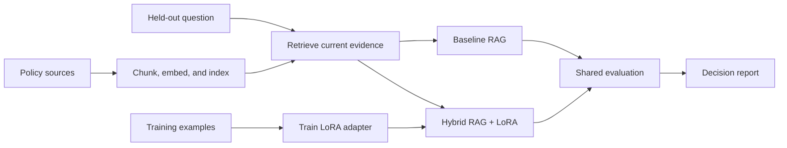

# Fine-Tuning + RAG Project

Use this repository as a **template** for your hybrid language-model
project. Build an assistant for the fictional Northstar customer-support team
that retrieves current policy evidence and uses a locally trained LoRA adapter to produce concise,
evidence-aware replies. Create pull requests in your own copy even if you are
working alone, and use them to track your progress.

This assignment combines the earlier work on
retrieval-augmented generation (RAG),
vector search, and parameter-efficient fine-tuning.
It follows the earlier strategy lesson by turning the selected hybrid pattern
into an assessed implementation with a real local fine-tuning run and a
measured comparison against a baseline RAG system.

## My Implementation

### Architecture

| Step | Module | What it does |
| --- | --- | --- |
| Data validation | [src/data.py](src/data.py) | Loads policies, training examples and held-out cases; checks IDs, source references and train/eval leakage |
| Retrieval | [src/retrieval.py](src/retrieval.py) | One chunk per paragraph, `all-MiniLM-L6-v2` embeddings, Qdrant (in-memory, cosine), `top_k=3`, threshold `0.30` |
| Prompt | [src/prompts.py](src/prompts.py) | One chat-template prompt shared by training and both answer paths |
| LoRA training | [src/training.py](src/training.py) | PEFT LoRA on SmolLM2-135M-Instruct (`q_proj`/`v_proj`, r=8, alpha=16), loss on answer tokens only |
| Answer paths | [src/generation.py](src/generation.py) | `base-only`, `rag-base` (baseline), `rag-lora` (hybrid); citation validation, status `answered`/`abstained`/`rejected` |
| Evaluation | [src/evaluation.py](src/evaluation.py) | Retrieval metrics once; relevance, faithfulness, style, decisions, latency per system |

New to RAG or LoRA? Start with the [Learning Guide](docs/LORA.md).

### Commands

Run from the project root after `uv sync` and `cp .env.example .env`:

```bash
uv run python -m src inspect-data                 # validate data, show sample chunks
uv run python -m src retrieve "your question"     # retrieval scores, no model
uv run python -m src train                        # real LoRA run (~70 s on a laptop CPU)
uv run python -m src ask --system rag-base "Can support change an address after packing?"
uv run python -m src ask --system rag-lora "Can support change an address after packing?"
uv run python -m src evaluate                     # writes reports/benchmark_results.md
uv run pytest tests                               # fast tests, no model downloads
```

### Results and conclusion

| System | Relevance | Faithfulness (served) | Decision accuracy | Answered / 10 answerable | Abstained / 4 unanswerable |
| --- | ---: | ---: | ---: | ---: | ---: |
| rag-base (baseline) | 0.000 | n/a (0 served) | 0.214 | 0 | 3 |
| rag-lora (hybrid) | 0.350 | 0.714 | 0.500 | 5 | 2 |

Retrieval is perfect on answerable cases (recall@3 = MRR = 1.0). The baseline
model never writes `[source-id]` citations, so validation rejects all its
answers. The adapter mainly teaches that citation habit (raw fact coverage only
rises from 0.55 to 0.65). It also makes the model answer two near-domain
unanswerable questions with invented facts. **Recommendation: revise; do not
deploy yet.** Full analysis, answers to the five questions, and next
experiments: [reports/evaluation_report.md](reports/evaluation_report.md).

## Learning Objectives

By the end of this repository, you should be able to:

- Build a hybrid RAG + LoRA system with a real, locally trained adapter.
- Benchmark the hybrid system against a baseline RAG pipeline on the same
  held-out cases.
- Separate retrieval quality from answer relevance, faithfulness, response
  style, and abstention behavior.
- Decide whether adaptation adds enough value to justify its training,
  deployment, and maintenance cost.

## Learning Path



| File / Folder | Description |
|---|---|
| [**Project Description**](project-description.md) | Scenario, milestones, deliverables, and acceptance checklist. |

### Additional Folders and Files

| File / Folder | Description |
|---|---|
| [**data/knowledge_base**](data/knowledge_base/) | Approved support policies the assistant may cite. |
| [**data/training**](data/training/) | Example support replies for training the LoRA adapter. |
| [**data/evaluation**](data/evaluation/) | Labeled questions for benchmarking both systems. |
| [**solution**](solution/README.md) | Runnable reference implementation and tests. Inspect after attempting the project. |
| [**.env.example**](.env.example) | Local model and retrieval configuration template. |
| [**pyproject.toml**](pyproject.toml) | Project configuration and dependencies. |
| [**uv.lock**](uv.lock) | Dependency lock file. |

## Setup

Use [uv](https://docs.astral.sh/uv/getting-started/installation/) 0.13.5 or newer
and Python 3.13.17 or a newer 3.13 patch release, as defined in
[`.python-version`](.python-version).

> [!NOTE]
> Throughout these steps, text in angle brackets like `<repo-name>` is a **placeholder**. Replace it, including the `< >` brackets, with your own value. For example, `cd <repo-name>` becomes `cd mle-finetuning-rag-project`.

### 1. Create the Repository from the Template

Click **Use this template** on GitHub.

When creating the repository:

- Set yourself as the **Owner**
- Choose a repository name
- Disable **Include all branches**
- Click **Create repository**

> [!IMPORTANT]
> If you are working in pairs or groups, only **one person** should complete this step.

---

### 2. Add Collaborators (Pairs/Groups Only)

If working with teammates:

1. Open the repository on GitHub
2. Go to **Settings → Collaborators**
3. Add your teammates as collaborators
4. Share the repository link with your team

Teammates should accept the invitation before continuing.

---

### 3. Clone the Repository

Copy the SSH URL from the **Code** button on GitHub, then run:

```bash
git clone <copied-ssh-url>
```

The copied SSH URL will look like `git@github.com:<your-username>/<repo-name>.git`.

---

### 4. Move into the Project Folder and Install Dependencies

The command below installs all dependencies and creates a virtual environment in `.venv/`.

```bash
cd <repo-name>
uv sync
```

The first training and evaluation runs download the configured public models from the [Hugging Face Hub](https://huggingface.co/docs/hub/index). The reference solution uses local Sentence Transformers embeddings, Qdrant local mode, and SmolLM2 with PEFT. The default base and embedding model revisions are pinned. Set `BASE_MODEL_REVISION` or `EMBEDDING_REVISION` explicitly when changing models. No hosted service or API key is required. Keep generated adapters, vector storage, and evaluation traces out of Git.

---

### 5. Set Up Environment Variables

Copy the default local model and retrieval settings:

```bash
cp .env.example .env
```

The reference solution runs locally without a hosted API key. Keep the default settings for your first run; `.env` lets you change them later.

> [!CAUTION]
> Never commit `.env`. It is git-ignored because environment files often hold secrets. Only `.env.example`, with placeholder or default values, belongs in the repository.

---

### 6. Open the Repository in VS Code

> [!NOTE]
> Make sure you open VS Code from the project root so it automatically detects the environment created by `uv sync`.

Launch VS Code in the project root folder:

```bash
code .
```

Select the Python interpreter in `.venv/` created by `uv sync`. Run the [reference solution commands](solution/README.md#run-the-reference-workflow) from the project root.

## Required Deliverables

Your repository must include:

- reproducible policy ingestion, chunking, embedding, indexing, and retrieval,
- a real local LoRA training command and saved adapter configuration,
- baseline RAG and hybrid RAG + LoRA answer paths using the same retriever,
- citation validation and abstention when evidence is unsupported,
- evaluation code that reports retrieval quality separately from answer
  relevance, faithfulness, style compliance, and decision accuracy,
- `reports/evaluation_report.md` with a per-case comparison, failure analysis,
  threshold decision, and prioritized next experiments,
- tests covering data contracts, retrieval metadata, unsupported questions,
  citations, and report generation,
- a concise README explaining architecture, commands, and conclusions.

## References & Further Reading

- [Hugging Face Causal Language Modeling](https://huggingface.co/docs/transformers/tasks/language_modeling)
- [Sentence Transformers Semantic Search](https://www.sbert.net/examples/sentence_transformer/applications/semantic-search/README.html)
- [Hugging Face PEFT LoRA guide](https://huggingface.co/docs/peft/developer_guides/lora)
- [Qdrant Local Quickstart](https://qdrant.tech/documentation/quickstart/)
- [Ragas Metrics](https://docs.ragas.io/en/stable/concepts/metrics/available_metrics/)
